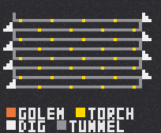

# Mining Golem

A Fabric mod for Minecraft 26.3 that adds a diamond-textured copper-golem-like helper
which digs a serpentine strip-mine network for you — gathering loot, lighting tunnels
with torches and bridging over holes, even while you are away.

|              |                                   |
|--------------|-----------------------------------|
| Minecraft    | 26.3                              |
| Fabric Loader| ≥ 0.19.5                          |
| Fabric API   | any for 26.3                      |
| Java         | ≥ 25                              |
| Side         | client + dedicated server         |

**Install:** drop `build/libs/mininggolem-1.0.0.jar` (and Fabric API) into your `mods` folder.

---

## Getting a golem

- **Spawn ritual** — right-click the *top face* of a diamond block while holding a jack
  o'lantern. Both blocks are consumed and the golem spawns on the spot.
  - The golem's dig direction = the direction you are looking when placing.
  - You are recorded as its *owner* (chat messages go to you).
  - Sneak to place a real jack o'lantern on a diamond block without triggering the ritual.
- **Spawn egg** — available in the creative spawn-eggs tab.
- **Picked-up golem** — a spawn egg that carries a stored golem (see below) restores the
  exact same golem: inventory, name, job plan and everything.

## Interacting with the golem

- **Right-click** — opens the GUI (works with any item in hand).
- **Sneak + right-click** — picks the golem up. It turns into a spawn egg item in your
  inventory holding *all* of its state (tools, torches, loot, name, direction). Place
  that egg again to re-deploy it, fully restored — **at the new position**: the old dig
  site plan is discarded, the golem is idle and will start a fresh serpentine where you
  placed it.
- The golem is **knockback-immune**, does **not wander** when idle, and never despawns.
- When it dies, it drops its entire inventory.

## The GUI

| Area                | What it is                                                                 |
|---------------------|----------------------------------------------------------------------------|
| Status (top right)  | Color-coded live status with a state dot: 🟢 Mining · ⚪ Idle · 🟠 Paused (out of torches/tools/liquid) · 🔴 Inventory full · 🔵 Done |
| Name field          | Type a name and press **Enter** (tooltip reminds you). While typing, *no key* closes the GUI (Escape first stops typing, then closes). The name shows above the golem and in its chat messages. |
| N / E / S / W       | **Dig direction** (current one is grayed out; hover for "Dig north/east/…"). Changing it stops a running job and clears the plan — press Start again to dig the new way. Clicking the current direction is always a no-op. |
| Start / Stop        | Sits beside the name field; toggles the mining job, the label reflects the current state |
| Left column (4)     | **Tool slots** — pickaxes *and* shovels, with greyed-out vanilla item icons as hints |
| Right column (4)    | **Torch slots** — torches (normal or soul)                                 |
| Center 4×9 grid     | **Loot** — everything the golem mines lands here, never on the ground       |
| Stats (right of your inventory) | **Blocks:** how many blocks the tools in its slots can still break (remaining durability, `0` when empty) · **Tunnel:** how far it can dig with its torches (one torch per 10 columns) |

The name, dig-direction and start/stop controls sit above the golem's inventory;
the background uses vanilla-style rounded corners.

The GUI live-updates while the golem works — you can watch loot and tool durability change.

## How it mines



*Top-down view. The real pattern uses 100-block rows and continues endlessly through new rings. Each row pair forms a closed loop — connected on the right side (turn connector) and on the left side (turn + short closing rung).*

- **Pattern:** an **endless chain of closed rings** — a tunnel row (100 blocks) in the
  work direction, a 3-block connector, a return row back, and a 2-block rung that closes
  the loop: **every pair of rows is connected at both ends**. Rings are chained on
  alternating sides, so the whole network is one connected maze of loops. There is no
  fixed length: the plan is extended ring by ring, and the golem keeps going until a
  stop condition hits (inventory full, no tools, unbreakable block, or you press Stop).
  **Stop + Start continues the same network** — old and new tunnels stay connected.
  Only two things start a fresh pattern: changing the dig direction in the GUI, or
  picking the golem up and placing it somewhere else.
- **Bore:** strictly horizontal, 1 wide × 2 tall, at the Y level where the job started.

```
   side view of the tunnel                     next column
   (already dug)                               to dig
  +--------------------------+-------+------+
  |                [T]       |  ###  | ###  |   [T] torch on the ground,
  |                          |  ###  | ###  |   every 10 columns
  |      (the golem)->       |  ###  | ###  |   ### = rock to break
  |          ## <- 1x2 bore  |  ###  | ###  |   ##  = head+foot level
  +--------------------------+       +------+
  | ====== bridged floor =======     | ###  |   === = filler blocks close
  +--------------------------------+------+   holes (caves, fallen gravel)
```
- It mines **only in front of itself** — no wandering off, no digging into walls at random.
- **Ores:**
  - an ore *in the bore* is vein-mined: the whole connected cluster goes into the
    inventory (up to 48 blocks per vein),
  - after a column is mined, all *now-visible faces* of the broken blocks are checked;
    ores the golem can actually harvest with a tool in its inventory are mined (with
    vein mining) before the tunnel continues.
- **Tools:** the matching tool is chosen per block — pickaxe for stone-type, shovel for
  dirt/gravel. It uses the *fastest tool that can really harvest* the block (a wooden
  pickaxe won't touch diamond ore). Break time scales with block hardness and tool tier,
  like a player's. Each broken block wears the tool; when one breaks, it automatically
  switches to the next tool slot.
- **Torches:** one every **10 columns**, placed on the ground behind it (wall-mounted as
  fallback, retried next column if the spot is blocked).
- **Loot:** mined blocks go straight into the inventory. Only when the inventory is full
  does excess drop on the ground — and the job stops with the status *Inventory full*.

## Safety & resilience

The golem is built to keep working in ugly conditions:

- **Gravel / sand:** suffocation is impossible. Blocks that land *inside* it are dug out
  immediately; falling blocks still airborne in the tunnel make it wait until they land,
  then mine them. A blocked bore is re-mined until it is clear.
- **Water / lava:** fire-immune, breathes underwater, cannot be pushed by currents, and
  paths straight through flooded or burning tunnels — no pausing.
- **No gaps in the floor:** holes below the golem and below the next column are bridged
  using solid blocks from its loot inventory (cobblestone, dirt, …).
- **Stays on its level:** if it falls into a hole it jumps back up; for deeper falls it
  stacks a lift block and climbs out.
- **Works while you're away:** while a job runs, the golem keeps its chunks loaded and
  ticking (vanilla chunk tickets) — it continues mining with no player nearby.
- **Resumes after save/reload:** waypoints, progress, inventory, direction and name all
  persist; an interrupted job continues where it stopped.

## Chat messages

Sent to the owner (or, if offline, all players within 32 blocks):

- `<Name> started digging.` / `<Name> resumed digging.`
- `<Name>: Paused — out of torches.` / `out of tools.` *(refill and it resumes on its own)*
- `<Name>: Stopped — inventory full.` / `unbreakable block ahead.`

## Debug mode

```
/mininggolem debug            # toggle
/mininggolem debug <true|false>
```

Requires op-level permissions. When on:

- mining is **10× slower** and walking runs at quarter speed — perfect for watching it work
- break/place targets are highlighted with dust particles:
  - 🔴 red — the block currently being broken
  - 🔵 blue — the torch spot candidate behind the dig position
  - 🟢 green — the bridging spot below the next column

## Building from source

```
./gradlew build
```

Output: `build/libs/mininggolem-1.0.0.jar` (+ sources jar).

Textures (entity, eyes, GUI, spawn egg) are generated by the
Python scripts in the repo root: `generate_textures.py`, `generate_golem_texture.py`,
`generate_spawn_egg.py`. The GUI's ghost slot hints are greyed-out vanilla item
textures (diamond pickaxe/shovel, torch), extracted from the Minecraft client jar
into `assets-src/vanilla/` and baked in by `generate_textures.py gui`.

### Project layout

```
src/main/java/com/michnhokn/mininggolem/
  MiningGolem.java                  entrypoint: entity/menu/ticket registration, /mininggolem command
  entity/MiningGolemEntity.java     inventory, status sync, pick-up, bridging, vein mining, NBT
  entity/goal/StripMineGoal.java    the serpentine strip-mine AI
  inventory/MiningGolemMenu.java    GUI slots + synced status/direction
  network/…                         C2S payloads: toggle, rename, set-direction
  item/ModItems.java                spawn egg
  spawn/SpawnRitualHandler.java     diamond block ritual + golem placement
src/client/java/com/michnhokn/mininggolem/client/
  render/…                          copper-golem-geometry model, renderer, held tool
  screen/MiningGolemScreen.java     GUI screen
```

## v2 ideas

- Digging down / staircase to a target Y level
- Config file (all constants are code-level constants for now)
- Pickaxe visibly swinging *with* the chop animation polish, more mining patterns
